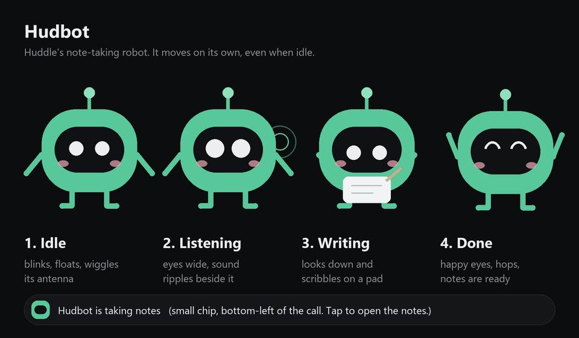
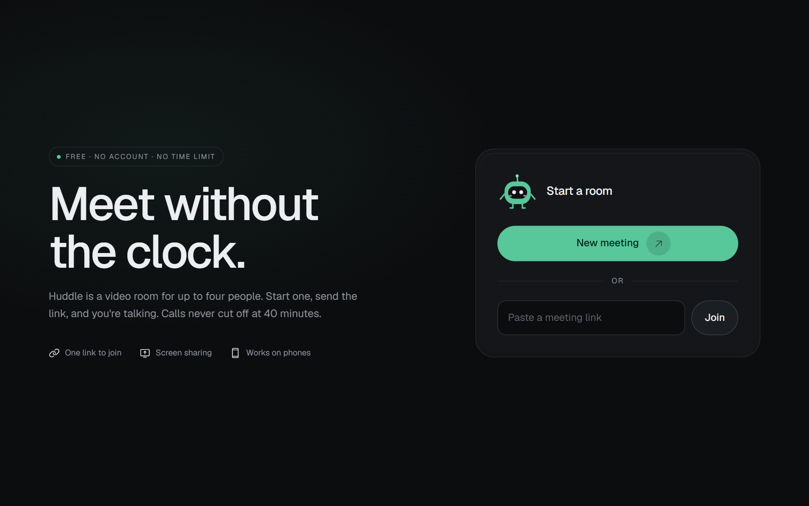
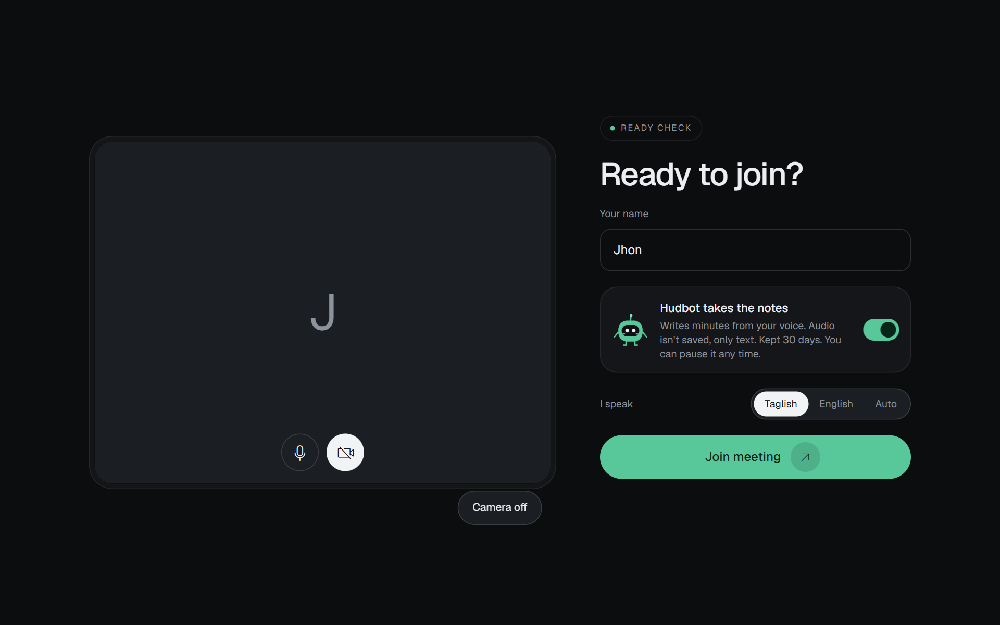
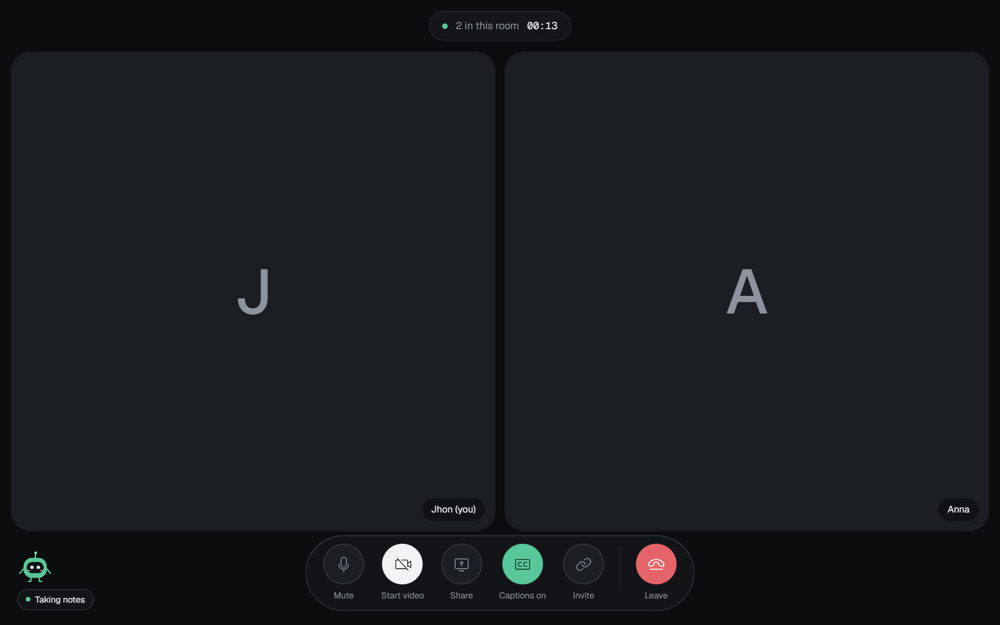
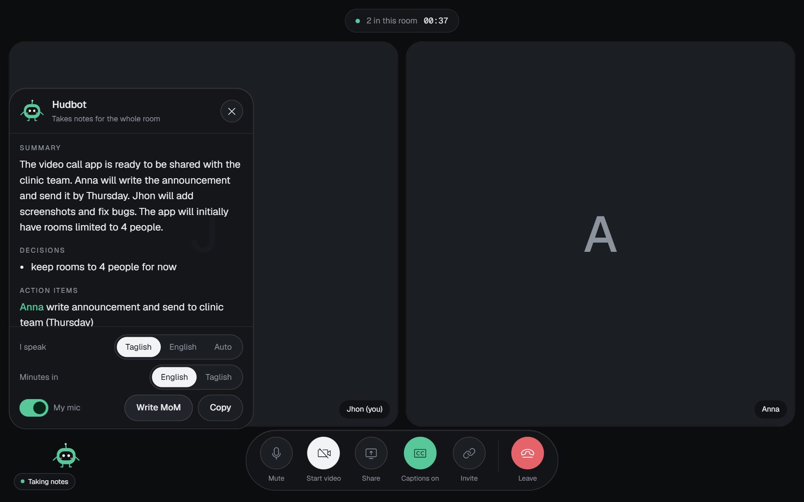
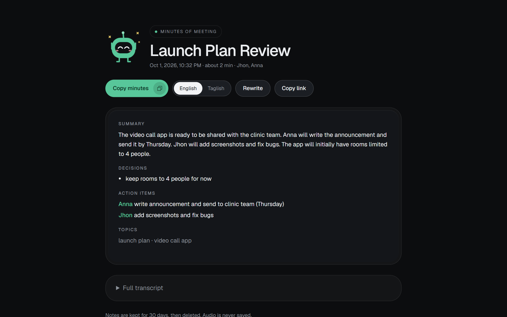
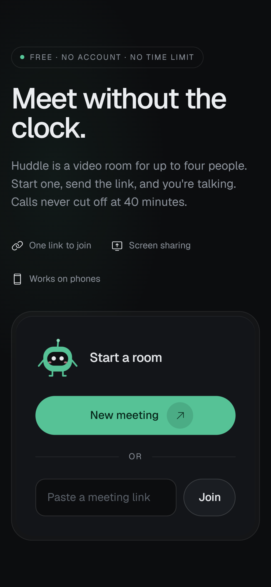
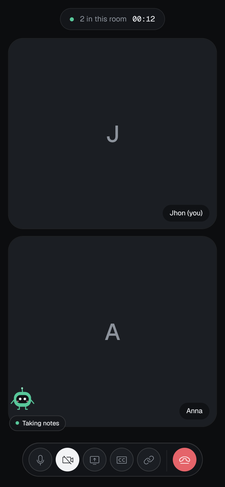
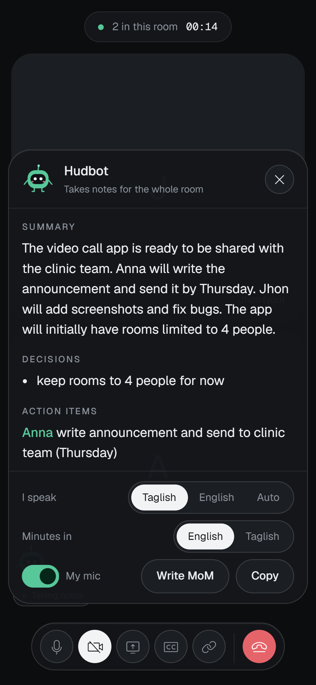
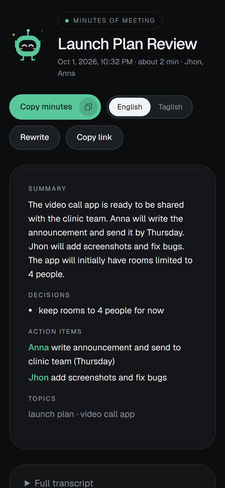

# Hudbot

**A free, open-source alternative to Zoom.** Video rooms in the browser with no account, no 40-minute cut-off and no per-seat fee. Comes with **Hudbot**, a small robot that listens, shows live captions and writes the minutes of the meeting for you.



> **Status:** the hosted app is not live yet. Because Hudbot is open source, you run your own copy on your own Cloudflare account. It takes about five minutes and is free for light use. See [Deploy your own](#deploy-your-own).

## Screenshots

| Home | Join screen |
| --- | --- |
|  |  |

| In a call | Live captions |
| --- | --- |
|  |  |

| Hudbot's notes panel | Minutes of meeting |
| --- | --- |
|  |  |

On a phone:

<p>
  
  
  
  
</p>

The screenshots use sample people and a short sample conversation. Cameras are off, so the tiles show initials.

## What you get

- **Rooms for up to 4 people.** Press *New meeting*, send the link, and you are in. No sign-up, no app to install.
- **No time limit.** Calls never cut off.
- **Video, audio and screen sharing.** Screen sharing works on desktop browsers. Phone browsers do not allow it.
- **Front and back camera switch** on phones.
- **Hudbot, the note-taker.** On by default. It turns what people say into a transcript, then into minutes of meeting: summary, decisions, action items with owners, follow-ups. Copy the text and send it to anyone.
- **Live captions** for everyone in the room, a few seconds after someone speaks.
- **Taglish, English or Auto** speech recognition. Minutes can be written in English or Taglish.
- **Host controls.** The person who presses *New meeting* is the host and can end the meeting for everyone. An ended link stops working. Unused links also expire after 24 hours.
- **Reconnects by itself** when a phone sleeps or switches apps.
- Dark, minimal design that works on phones.

## Privacy

- No accounts and no tracking.
- Audio is **never saved**. Each person's own microphone is cut into short clips, turned into text, and the clip is thrown away.
- Only the text is kept, for **30 days**, then Cloudflare deletes it.
- Everyone in the room sees that Hudbot is on, and each person can pause it for their own microphone.
- Video and voice go directly between browsers (peer to peer). They do not pass through the server unless a strict network needs a relay.

## How it works

```
Browser A  <-- video / audio (WebRTC, peer to peer) -->  Browser B
    |                                                        |
    +----------------- WebSocket (signaling) ----------------+
                              |
                  Cloudflare Worker + Durable Object (one per room)
                    - passes call setup messages between people
                    - holds host key, ended flag, transcript lines
                    - Workers AI: Whisper (speech to text), Llama (minutes)
```

- **Frontend:** plain HTML, CSS and JavaScript in `public/`. No build step, no framework.
- **Backend:** one Cloudflare Worker (`src/worker.js`) with a Durable Object class `Room`. Each room is one Durable Object.
- **Speech to text:** `@cf/openai/whisper-large-v3-turbo` through Workers AI.
- **Minutes:** `@cf/meta/llama-3.3-70b-instruct-fp8-fast` through Workers AI.
- **Relay for strict networks (optional):** Cloudflare Realtime TURN.

## Deploy your own

You need a free [Cloudflare account](https://dash.cloudflare.com/sign-up) and Node.js 18 or newer.

```bash
git clone https://github.com/<your-name>/hudbot.git
cd hudbot
npm install
npx wrangler login
npx wrangler deploy
```

The first deploy may ask you to choose a `workers.dev` subdomain. If the command says the name is taken, open the Cloudflare dashboard, go to **Workers & Pages**, find the **Subdomain** setting, register one, and run `npx wrangler deploy` again.

When it finishes, Wrangler prints your address, for example `https://huddle.your-subdomain.workers.dev`. Open it and press **New meeting**.

Hudbot (Workers AI) needs no extra setup. It uses your account's free daily allowance. Check Cloudflare's current [Workers AI pricing](https://developers.cloudflare.com/workers-ai/platform/pricing/) for the limit. If you run out, calls keep working and Hudbot pauses until the next day.

### Optional: TURN relay

About 1 in 10 calls on strict networks (some offices, some mobile carriers) cannot connect directly and need a relay. To add one:

1. In the Cloudflare dashboard, create a TURN key under **Realtime → TURN**.
2. Save the two values as secrets:

```bash
npx wrangler secret put TURN_KEY_ID
npx wrangler secret put TURN_API_TOKEN
```

Without them the app falls back to a public STUN server only.

### Run it locally

```bash
npm run dev
```

Hudbot's AI calls still go to Cloudflare, so you must be logged in with `wrangler login`. Camera and microphone need `localhost` or HTTPS.

### What about Vercel?

Not supported. Vercel cannot hold the always-on WebSocket and the per-room state that the Durable Object provides. Hosting only the static files on Vercel would still need a signaling server somewhere else. Pull requests that add another backend are welcome.

## Project layout

```
public/index.html    the whole app: lobby, join screen, call, captions, notes page
public/hudbot.js     Hudbot's drawing and the code that makes it move on its own
public/hudbot.css    Hudbot's animations
src/worker.js        signaling, rooms, host, expiry, speech to text, minutes
wrangler.jsonc       Cloudflare configuration
docs/                images used in this README
```

## Limits

- Up to **4 people** per room. Calls are peer to peer, and every extra person adds load on everyone's connection. Bigger rooms would need a media server (SFU).
- No recording yet. No chat yet.
- Screen sharing is not available in phone browsers.
- Speech recognition is not perfect, especially with noise and mixed languages. Check names and numbers before you send the minutes.
- Captions and minutes come from each person's own microphone. A person who pauses Hudbot is not captioned.

## Ideas for contributors

- Chat and reactions
- Recording
- Bigger rooms with an SFU
- More languages for captions and minutes
- Another backend adapter (for example Node + WebSocket)

## License

[MIT](LICENSE). Use it, change it, host it, sell it.
